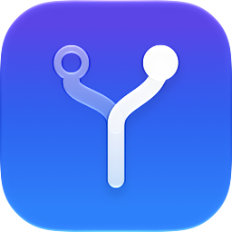

<p align="center">
  <picture>
    <source media="(prefers-color-scheme: dark)" srcset="docs/icon-dark.png">
    
  </picture>
</p>

<h1 align="center">ContextSwitch</h1>

<p align="center">
  A macOS menu bar app that launches and quits apps based on where you are<br>
  and what's plugged in.
</p>

> [!WARNING]
> **ContextSwitch is completely vibe coded.** None of it was written by hand:
> the author described what they wanted, and an AI coding agent wrote all of
> the code, the tests, the build scripts and the docs, this README included.
> It works on the author's Mac, but nobody has audited it, and it launches
> and quits apps on yours. Use it at your own risk, and try a new profile
> with [`--dry-run`](#command-line) before trusting it.

## What it does

You describe your situations as **profiles**. Each one has conditions that
say when it applies, and a list of apps to launch or quit when it does. When
your network or connected devices change, ContextSwitch picks the profile
that matches and sets your apps up for it.

For example:

- **Office**: on the office Wi-Fi, or the company VPN's DNS domain is set.
  Launch Slack and Outlook, quit Steam.
- **Desk**: your dock's Ethernet adapter is connected. Launch your
  monitoring tools and OpenRGB in server mode.
- **Mobile**: no conditions, so it's the fallback when nothing else matches.
  Quit everything that drains the battery.

## Features

### Conditions

| Condition | Matches when |
| --- | --- |
| Wi-Fi Network | You're on a Wi-Fi network with this name. |
| Ethernet Network | A wired connection's router has this MAC address, i.e. you're plugged into that particular network. |
| Ethernet Adapter | This Ethernet adapter, such as your dock's, is connected. |
| DNS Domain | This DNS domain or search domain is set, as many VPNs do. |
| Router IP, Router MAC | Your router has this address. |
| Subnet | Your IPv4 address is in this range, e.g. `192.168.1.0/24`. |
| Place | You're within a radius of a spot on the map: your current location, or coordinates you enter. |
| USB Device | A USB device of this model is connected, or only this unit (by serial number). |
| Display | A display of this model is connected, or only this unit (by serial number). |

Conditions combine with **and**, **or** and **not**, and any of them can be
timed: "dock *not* connected **for 5 min**" only counts once it has held for
five minutes, so a quick unplug doesn't switch profiles.

When several profiles match, the one with the highest priority wins. A
profile with no conditions is the fallback. ContextSwitch waits for the
network to settle for a few seconds before switching, so joining a network
doesn't launch and quit apps at every step.

### Apps

- Each app in a profile is set to **Launch**, **Quit** or **Ignore**.
- Besides apps, a profile can run scripts and command-line tools.
- Launch arguments (e.g. `--server --port 6742`) can be pasted the way you'd
  type them in Terminal.
- **Start the program directly** runs the executable inside an app, as
  Terminal does. Use it for server or daemon modes that never finish
  launching as an app, which would otherwise leave the Dock icon bouncing.
- Apps are quit the normal way, like ⌘Q, so they can ask you to save your
  work. Programs started directly, scripts and tools get `SIGTERM` instead,
  which can't ask.
- "Add App…" lists `/Applications` by default. Add more folders, such as
  `~/Applications` or `/opt/bin`, in Settings.

### Menu bar

- See the active profile, the current network, and a countdown when a
  timed switch is coming up.
- Turn **Auto-switch** on or off. Picking a profile by hand turns it off, so
  your choice sticks.
- Flip an app on or off for the moment. The override lasts until the
  profile is activated again.
- Launch ContextSwitch at login (Settings ▸ General).

## Install

1. Download the zip from the [latest release](https://github.com/tautomer/mac-app-switcher/releases/latest).
2. Unzip it and move **ContextSwitch.app** to `/Applications`.
3. Open it. The first time, macOS refuses because the app isn't notarized.
   Go to **System Settings ▸ Privacy & Security**, scroll down to
   **Security**, click **Open Anyway** and confirm.
4. Click the ContextSwitch icon in the menu bar and choose **Edit Profiles…**.

Requires macOS 14 Sonoma or later.

## Permissions and privacy

- **Location** is needed only for **Wi-Fi Network** and **Place**
  conditions, because macOS hides Wi-Fi network names from apps without it.
  ContextSwitch asks for it when you add one of those. Places use region
  monitoring (geofencing), not continuous tracking. Every other condition
  works without any permission.
- Nothing leaves your Mac. ContextSwitch makes no network requests, and
  your profiles are saved locally in
  `~/Library/Application Support/ContextSwitch/profiles.json`.

## Command line

The app's executable also works as a command-line tool, for scripts and
automations:

```sh
alias contextswitch=/Applications/ContextSwitch.app/Contents/MacOS/ContextSwitch

contextswitch --list                      # profiles, and which match right now
contextswitch --switch                    # switch once to the matching profile
contextswitch --profile Office            # switch once to a profile by name
contextswitch --profile Office --dry-run  # show what would launch or quit
```

```
$ contextswitch --list
Network: Wi-Fi “Home-WiFi” · router 192.168.1.1
  ✓ Home    priority 2   ← current match
  ✗ Office  priority 1
  · Mobile  fallback
```

If the menu bar app is running, `--switch` and `--profile` are carried out
by it, so the menu stays in sync. Unlike picking a profile from the menu,
they leave auto-switch as it is. Exit codes: `0` success, `1` no profile
matches, `2` no profile with that name, `64` usage error.

## Building from source

You need Xcode 26 or later and [XcodeGen](https://github.com/yonaskolb/XcodeGen)
(`brew install xcodegen`).

```sh
scripts/build.sh           # Release build -> build/ContextSwitch.app
scripts/build.sh --test    # run the unit tests first
```
